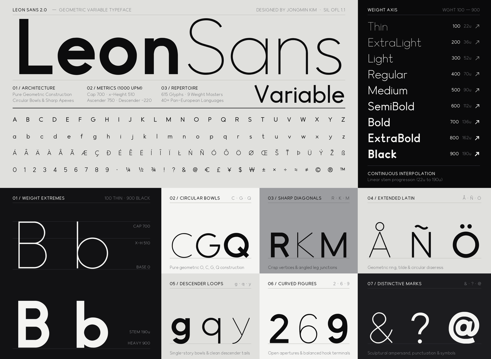

# Leon Sans

Leon Sans is a geometric sans-serif typeface designed by Jongmin Kim. Version 2.0 is a variable TrueType family with a `wght` axis from 100 (Thin) to 900 (Black).

[](https://leon-kim.com/preview/)

**[Interactive Type Specimen & 467-Glyph Preview → https://leon-kim.com/preview/](https://leon-kim.com/preview/)**

This repository contains the installable font and editable font sources. The original JavaScript drawing library is maintained separately at [cmiscm/leonsans](https://github.com/cmiscm/leonsans).

## Font

`fonts/variable/LeonSans[wght].ttf`

The typographic family name is **Leon Sans** and the font version is **2.000**. The default variable-font instance is Thin (100); Regular is available at 400. Nine named weights are provided. Some legacy menus display the default instance as **Leon Sans Thin**.

The character set (467 glyphs) supports Google Fonts Latin Core and extended European Latin letters, numerals, superscripts and subscripts (`⁰`–`⁹`, `₀`–`₉`), fractions (`¼ ½ ¾ ⅓ ⅔`), currency symbols, arrows, mathematical and scientific symbols, punctuation, and combining marks.

## Build from source

Python 3.12+ is supported for building from source.

```sh
python -m venv .venv
source .venv/bin/activate
python -m pip install -r requirements.txt
python scripts/build.py
```

The eight editable UFO masters and designspace are in `sources/`. Fontmake compiles them into a variable TTF; `scripts/finalize.py` applies naming, OpenType metadata, safe UPM conversion and non-hinting rasterizer settings. The build does not require any proprietary font editor, previous binary release or external file from the designer's computer.

To run the Google Fonts checks:

```sh
fontbakery check-googlefonts 'ofl/leonsans/LeonSans[wght].ttf'
```

## Version 2.0

- Variable weights 100–900 with revised joins, 1:1 circular bowls, and optical spacing.
- Expanded Latin coverage, including stroked letters, capital sharp S and combining accents.
- Complete superscript/subscript digits, vulgar fractions, geometric arrows, and mathematical/scientific symbols.
- Contextual dot removal for i/j and i-ogonek before above accents.
- GPOS kerning, mark and mark-to-mark positioning; canonical composition with `ccmp`.
- Editable UFO sources and a reproducible open-source build.

Version 1 font binaries remain available in Git history. This repository's current `fonts/` directory contains the 2.0 family.

## License and authorship

Copyright 2019 The Leon Sans Project Authors (https://github.com/cmiscm/leonsansfont). Licensed under the [SIL Open Font License 1.1](OFL.txt).

[Interactive Type Specimen (`leon-kim.com/preview/`)](https://leon-kim.com/preview/) · [Designer website](https://leon-kim.com/) · [Google Fonts submission discussion #2169](https://github.com/google/fonts/issues/2169)

